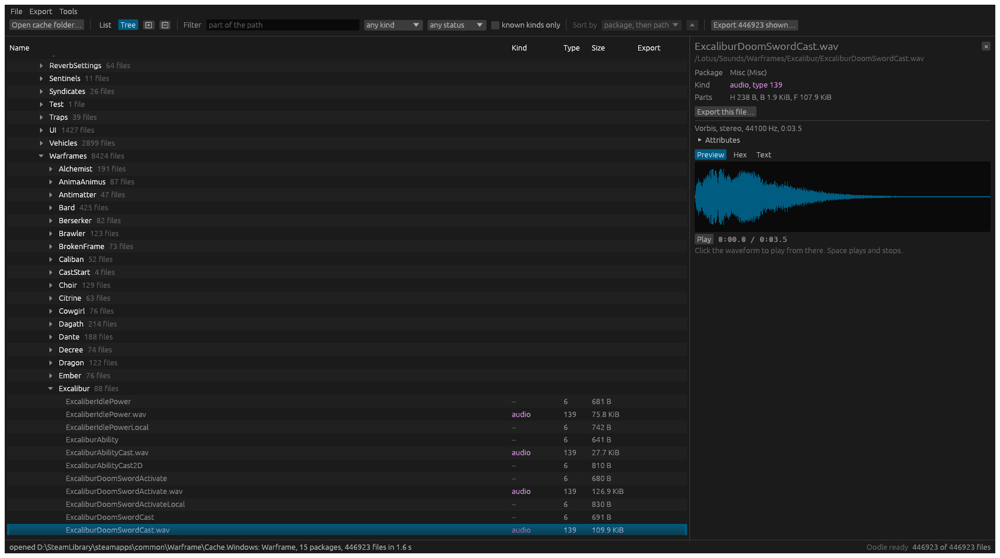
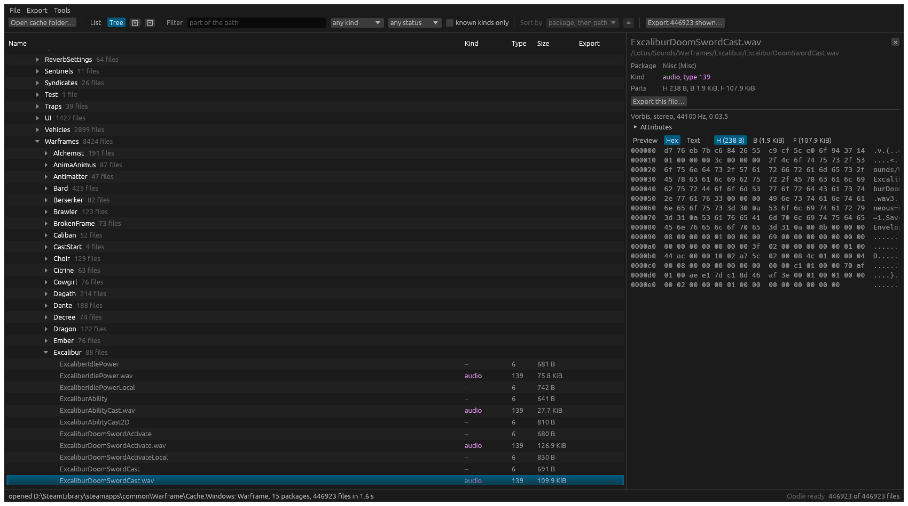

# wfscan

Browse Warframe's game files and export its textures, models and sounds to standard formats.

Warframe keeps everything in a `Cache.Windows` folder of packages: about 450,000 files, 50 GB on disk. wfscan reads them, records every file in a manifest, and writes out the ones it understands as DDS or PNG, glTF, and Ogg or WAV. It comes as a command-line tool and a desktop app, and it never writes to the game's files.

It's a ground-up Rust replacement for [Warframe-Exporter](https://github.com/Puxtril/Warframe-Exporter), and a sibling of [zscan](https://github.com/xRopers/zscan) (compressed streams), [texscan](https://github.com/xRopers/texscan) (textures) and [audscan](https://github.com/xRopers/audscan) (audio): an index writes a JSON manifest, and later steps work from it.

- **Textures** as DDS (the game's own data with every mip, cube face and layer) or PNG.
- **Models** as binary glTF (`.glb`): geometry, texture coordinates, skeleton and skin weights.
- **Sounds** as Ogg Vorbis, Ogg Opus or WAV, without re-encoding, including the Vorbis sounds that make up more than half the game's audio and that the original exporter doesn't read.
- **A desktop app**: every file as a sortable list or a folder tree, with texture, model and sound previews, a sound player, and a hex or text view of any file.
- **A manifest** of every file, so a later export only does what changed, `diff` shows what a game update added or removed, and `report` shows what wfscan can and can't read.



**Status: early.** Textures, sounds and most models export; materials, levels, shaders and animations don't yet. See [What works](#what-works).

wfscan is not affiliated with Digital Extremes. It only reads the cache, and it doesn't include any game data.

## Download

Windows x64 builds are on the [Releases](https://github.com/xRopers/wfscan/releases) page. The zip holds `wfscan.exe` (command line) and `wfscan-gui.exe` (desktop app). Nothing to install: the C runtime is built in.

### You need an Oodle library

Warframe compresses its cache with Oodle, which wfscan doesn't include and Warframe doesn't ship as a file. Point wfscan at an `oo2core_*.dll` from another game you own (many Unreal Engine games have `oo2core_9_win64.dll` in their folder):

- command line: `--oodle-dll PATH`, or set `WFSCAN_OODLE_DLL`;
- desktop app: **Tools > Oodle library…** (remembered between runs).

Without one, only `wfscan info` works.

## Desktop app

```bash
wfscan-gui [--oodle-dll PATH] [Cache.Windows folder]
```

Open the game's `Cache.Windows` folder (or drop it on the window). It's indexed in a couple of seconds, and every file is listed.

- **List or Tree.** The list has one sortable row per file. The tree shows packages and folders that open and close; with a filter typed in, it shows the matches unfolded.
- **Filter** by part of the path, by kind (texture, model, audio…) and by how the last export ended. **Sort by** path, file name, kind, type, size or status.
- **Click a file** for its details. Under **Preview**: textures are shown, models can be turned and zoomed, sounds get a waveform and a player (click the waveform to play from there; Space plays and stops). **Hex** and **Text** show any of the file's parts as they are in the cache.
- **Export** the selected file or everything shown, with textures as DDS or PNG and sounds in their own format or as WAV.
- **Tools > Coverage** shows how many files of each type there are and how their exports ended.

Up and down arrows move through the files.



Playback uses Windows' own audio output, so it's Windows-only.

## Command line

```bash
wfscan info Cache.Windows                                # packages, file counts, sizes
wfscan index Cache.Windows -o manifest.json              # record every file
wfscan export Cache.Windows -m manifest.json -d out/     # export everything wfscan can
wfscan export Cache.Windows -m manifest.json -d out/ --kinds audio --path /Lotus/Music/
wfscan export Cache.Windows -m manifest.json -d out/ --kinds texture --texture-format png
wfscan report -m manifest.json                           # what exported, what failed and why
```

`Cache.Windows` is in the game's folder (for Steam, `steamapps\common\Warframe\Cache.Windows`).

```
D:\...\Warframe\Cache.Windows: Warframe, 15 packages
package                parts      files    stale       in cache   decompressed
AnimRetarget           HB        11,667      144      218.5 MiB     1739.7 MiB
LightMap               HBF       60,518       11    12692.1 MiB    29490.9 MiB
Misc                   HBF      249,660      243    12685.8 MiB    18991.2 MiB
Misc_en                HBF       30,306        0     1304.4 MiB     1407.5 MiB
Texture                HBF       69,135       15    22281.9 MiB    70918.4 MiB
...
total                           446,923    1,269    50473.8 MiB   123926.6 MiB
```

All commands:

```
wfscan info    <Cache.Windows>
wfscan index   <Cache.Windows> [-o manifest.json] [--hash] [--full-headers] [--no-stale]
wfscan list    -m manifest.json [--package P] [--path PREFIX] [--type N] [--kind K] [--status S] [--failed] [--stale]
wfscan export  <Cache.Windows> -m manifest.json -d out/ [--package P] [--path PREFIX] [--kinds K,K]
               [--texture-format dds|png] [--audio-format native|wav] [--changed-since old.json] [--dry-run] [--force]
wfscan raw     <Cache.Windows> --path FILE|FOLDER/ [--package P] -d out/
wfscan diff    old.json new.json [--list]
wfscan report  -m manifest.json [--errors N] [--unknown]
```

Every command takes `--json`. `-j N` sets the number of threads.

- **One bad file never stops a run.** Every file ends as `ok`, `failed`, `unsupported` or `skipped`, with a reason, recorded in the manifest. `report` groups the failures, so a format changed by a game update shows up as one line.
- **Exports are incremental.** A file that was exported before, and whose output is still there, is skipped. After a game update, index again and pass the old manifest as `--changed-since` to export only what changed. `--force` exports everything again.
- **`--dry-run`** runs the exporters and reports sizes without writing anything.
- **`raw`** writes a file's decompressed parts untouched, for working out formats.
- **wfscan refuses to read a cache the game has open for writing** (`--allow-in-use` overrides). Close the game and its launcher first.

## What works

Measured on the September 2026 cache (446,923 files) with a Core Ultra 9 285K.

| | Files | Exported | Notes |
|---|---|---|---|
| Index | 446,923 | | 1.6 s; with `--hash` (reads and checksums all 124 GiB) 22 s |
| Textures | 129,645 | 128,668 | 977 are in pixel formats wfscan doesn't know. 98 GiB as DDS |
| Sounds | 88,780 | 88,780 | 9.5 GiB in their own formats, 84 GiB as WAV |
| Models | 57,698 | 50,753 | see below. 4.9 GiB |

### Textures

- **DDS** is exact: the game's compressed data behind a standard header (always the DX10 one), with every mip and every cube face, array layer or volume slice.
- **PNG** is the top mip decoded to 8-bit RGBA, one file per face, layer or slice. HDR textures are clamped, so use DDS for those.
- BC1 to BC7, BGRA8, A8 and R16 are read. Many textures are stored at half or a quarter of the size they were made at; you get the stored size.
- Not checked: the order of cube faces, and sRGB against linear.

### Sounds

- **Vorbis** sounds become `.ogg`, **Opus** sounds `.opus`, **PCM** sounds `.wav`, with the game's audio data unchanged. `--audio-format wav` decodes everything to 16-bit WAV instead, which every program opens but is nine times larger.
- The game stores its Vorbis sounds without the header packets a player needs. Those are exactly what the libvorbis 1.3.7 encoder writes at a handful of settings, so wfscan has them built in, generated from libvorbis (`tools/vorbis-headers`); nothing is taken from the game.
- **A few Vorbis sounds may come out as noise.** For 44.1 kHz sounds there are two possible header sets and nothing in the file says which one applies. wfscan decodes the start with both and keeps the cleaner result, which can be wrong for very quiet sounds.
- Checked: every sound decodes to exactly the length its header states, and exported `.ogg` and `.opus` files read back to the same samples as decoding the sound directly.

### Models

- Static, level and rigged models (types 102, 109 and 281) export with positions, two sets of texture coordinates, baked ambient occlusion (as `_OCCLUSION`), and for rigged models the skeleton and skin weights.
- **No normals or tangents**: how the game packs them isn't worked out. Viewers compute their own.
- **Materials are names only.** Each mesh's material path is in the glTF material's `extras.path`; no textures are linked yet.
- Only the most detailed level of each mesh is exported.
- 6,890 models are `unsupported`: 2,323 hold only collision data, and the rest are of types with no reader yet (terrain and some packed layouts). 55 fail.

### Not yet

Materials, levels and landscapes, shaders, animations, `Packages.bin` and `Languages.bin`. Soulframe's cache should read the same way but hasn't been tried, and its models have no reader. Warframe caches from before the 2020 "Ensmallening" are recognised and refused.

`wfscan report -m manifest.json --unknown` lists the file types wfscan has no name for, with counts and sample paths.

## The manifest

One JSON line per file: its package and path, the offset, sizes and timestamp of each of its parts (and a CRC-32 with `--hash`), its type number, and how its last export ended. It's what `list`, `export`, `diff` and `report` work from, and it's meant to be read by other tools too.

A file's kind (texture, model…) isn't stored: it's looked up from wfscan's type table each time, so a newer wfscan understands an older manifest better.

## Build

Rust 1.95 or later (1.89 for the command line alone):

```bash
cargo build --release
```

Optional features, all on by default: `oodle` (read Oodle blocks through your own library), `png` (PNG output and texture previews), `audio` (decoding sounds to WAV and for playback).

Tests use small made-up caches from `crates/wfscan-fixtures`; there is no game data in this repository. To run the tests that read a real cache:

```bash
WFSCAN_CACHE_DIR=".../Cache.Windows" WFSCAN_OODLE_DLL=".../oo2core_9_win64.dll" cargo test --release -p wfscan-core real_ -- --nocapture
```

## How it was made

The file formats were learned from Warframe-Exporter and its cache library LotusLib by Puxtril, and from sehnryr's lotus-lib for audio, and then checked and extended against the real cache. Those projects have no license, so no code was copied or translated from them: every reader here was written from a description of the format. Each format file's comments say where its facts came from.

## License

GPL-2.0-or-later; see `LICENSE`.

- Builds with the `png` feature include Basis Universal (Apache-2.0) through texscan, which makes those binaries GPL-3.0-or-later in effect.
- The built-in Vorbis header sets come from libvorbis, under the BSD license in `crates/wfscan-core/data/COPYING-libvorbis`.
- wfscan doesn't include Oodle. You supply your own copy.
